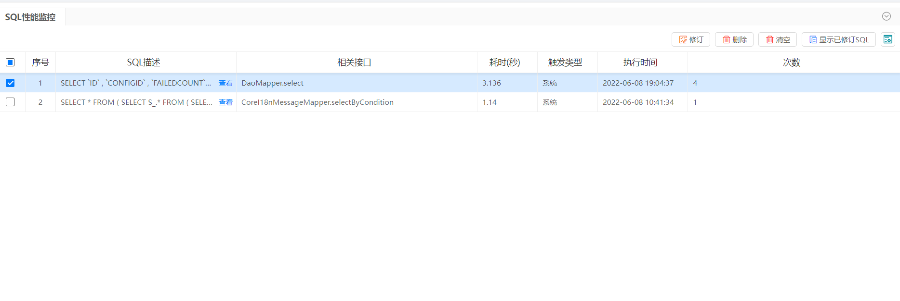
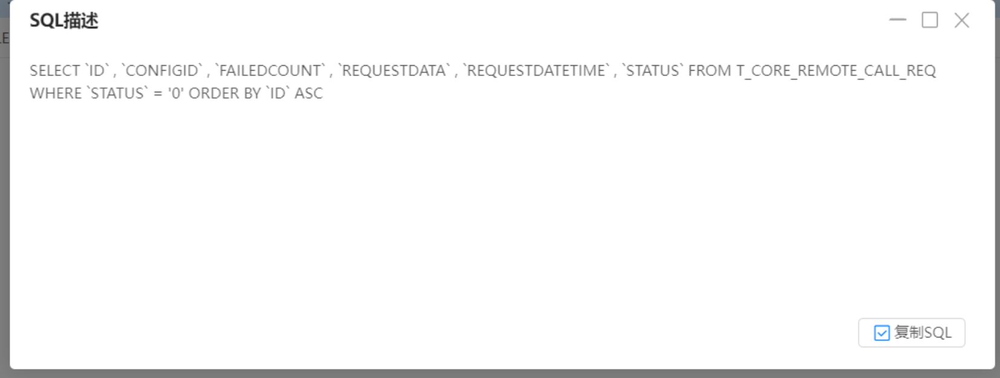

# >> 1.1.14

# 1. 版本依赖关系

#### 1. gikam-core-common 1.1.14 微服务基于 gikam-core-common 1.1.13
#### 2. gikam-core-base 1.1.14 微服务基于 gikam-core-base 1.1.5.1

#### 3. gikam-core-report 1.1.14 微服务基于 gikam-core-report 1.1.9

#### 4. gikam-core-web 1.1.14 微服务基于 gikam-core-web 1.1.13

#### 5. gikam-core-font 1.1.14 新增微服务

**注意事项：此次对sunway-app.dll/sunway-app.so文件做过修改，项目更新后先删除项目根目录下的历史dll/so文件**。

# 2. pom 文件如下修改：

```xml
<dependency>
    <groupId>com.sunwayworld.cloud</groupId>
    <artifactId>gikam-core-common</artifactId>
    <version>1.1.14</version>
</dependency>
<dependency>
    <groupId>com.sunwayworld.cloud</groupId>
    <artifactId>gikam-core-base-service</artifactId>
    <version>1.1.14</version>
</dependency>
<dependency>
    <groupId>com.sunwayworld.cloud</groupId>
    <artifactId>gikam-core-report-service</artifactId>
    <version>1.1.14</version>
</dependency>
<dependency>
    <groupId>com.sunwayworld.cloud</groupId>
    <artifactId>gikam-core-web</artifactId>
    <version>1.1.14</version>
</dependency>
<dependency>
    <groupId>com.sunwayworld.cloud</groupId>
    <artifactId>gikam-core-font</artifactId>
    <version>1.1.14</version>
</dependency>
```

# 3. 修复问题如下：

#### 1. **本次补丁需要更新 SQL，SQL 内容请在 QQ 群【SWLIMS V12 开发交流群】群文件【SWLIMS V12 补丁\_1.1.14.zip】-> 1.1.14 补丁 sql 文件夹中查看**

#### 2. 新增特殊字符支持

为了方便各事业部对特殊字符的使用，在核心中增加了`gikam-core-font`微服务，该微服务存放的是特殊字符字体库，研发中心会根据各行业的特殊字符需求不断更新此字体库。

#### 3. 新增系统监控功能


##### 3.1  SQL性能监控

（1）SQL性能监控是为了监控系统运行过程中出现的慢SQL，然后将这些慢SQL的信息展现在页面上，让开发和实施人员能较为直观的根据慢SQL产生的相关接口去做适当的优化，从而提高系统性能。

（2）慢SQL判定依据，当SQL的执行时间超过了在项目配置文件所配置的key值，那么该SQL被判定为慢SQL，反之，则不是。

（3）配置SQL性能监控，项目配置文件application.properties/yml 新增配置Key，用于开启SQL性能监控，默认值为0：
```yaml
#application.properties
sunway.mybatis.long-query-time = 0
#application.yml
sunway:
  mybatis:
    long-query-time: 0
```
其单位是毫秒，0表示不开启慢SQL监控功能。若开启配置，配置大于0的数值，建议设置到3000毫秒以上**切勿设置过小，影响系统性能**。

（4）打开系统监控->性能监控菜单，进入SQL性能监控页面。页面上能看到SQL描述，通过查看按钮可以看到完整的慢SQL，同时提供了复制按钮，用于将SQL复制到剪切板上；相关接口，是哪个的类的哪个方法所产生的慢SQL；触发类型分为：系统触发（比如定时任务）和用户触发（当前登录用户操作所记录的慢SQL）。




（5）修订功能，用于将优化过的慢SQL或者无法继续优化的慢SQL进行修订，该条记录更改为已修订状态，修订后展示在已修订SQL列表中，通过按钮“显示已修订SQL”展示已修订列表界面，修订后将不更新次数字段。


##### 3.2  错误日志

（1）功能介绍：在后端代码运行出现报错时候，截取日志里面的关键信息。通过错误日志页面展示的信息能够快速找到报错的地方，便于开发和实施人员后续的排查和修改。

（2）打开系统监控->错误日志菜单，进入错误日志页面，展示应用出现错误时截取到日志的信息以及它的相关接口、业务来源、产生的时间和触发类型。触发类型分为：系统触发（比如定时任务）和用户触发（当前登录用户操作所产生的错误信息）。


（3）修订按钮介绍：通过错误日志里的业务来源和相关接口去查找发生异常的地方，知道产生的原因，改变错误日志状态。

（4）按钮功能描述：修订按钮用于将优化过的错误日志进行修订，更改为已修订状态，修订后展示在已修订错误日志列表中，通过按钮“显示已修订错误日志”展示已修订列表界面，修订后将不更新次数字段。

（5）查看完整信息按钮：可以查看完整错误日志信息，复制按钮支持将错误日志复制到剪切板中方便粘贴排查原因。


##### 3.3 服务监控

（1）功能介绍：对系统运行的各个指标进行监控，根据各个指标设定的阈值，进行自动告警提示。使工作人员得到消息后，能够第一时间做出响应，保证系统的正常运行。

（2）打开系统监控->服务监控界面，页面展示的是对服务器CPU、内存、硬盘、系统请求指标、用户数等数据的监控，根据服务器配置和项目运行情况设定CPU、内存、硬盘、数据库连接池告警阈值，当达到设定阈值后自动以邮件或短信的形式告警提示。

（3）告警设置：打开系统监控->服务监控，在预警栏里如图告警设置按钮，点击后弹窗展示阈值设置界面。


（4）告警阈值：CPU告警阈值、内存告警阈值、硬盘告警阈值、数据库连接池告警阈值，用于配置触发系统自动告警的阈值（整数），当服务器某项指标或者应用某项指标大于该阈值时，通过邮件或者短信发送告警信息给通知人。

（5）通知人方式：告警通知人邮箱、告警通知人手机 字段配置值用于配置自动告警通知对象，可以填写多个邮箱或手机号，以英文逗号的形式分隔。

说明：短信通知功能需在项目自行实现接口`com.sunwayworld.module.sys.sms.core.CoreSmsManager`。


（6）开启服务监控时需要在项目配置文件application.properties/yml文件中配置以下参数：

```yaml
#application.properties
#spring.profiles.active配置项添加monitor配置 。
spring.profiles.active=monitor
#spring.application.name配置应用名。多应用节点部署时，该配置项不可重复
spring.application.name=app1
#sunway.app.host.name配置服务器名。多应用节点部署时，该配置项不可重复
sunway.app.host.name=server1 

#application.yml
spring:
    profiles: 
       active: monitor
    application:
            name: xxxx
sunway:
    app:
        host:
            name: xxxx
```

（7）开启邮件提醒需要在项目配置文件application.properties/yml配置以下参数：

```yaml
#application.properties
#邮件协议类型（默认为generic，该项配置可忽略）
sunway.mail.protocol.type=generic
#邮箱主机地址
spring.mail.host=smtp.mxhichina.com
#是否开启认证
spring.mail.properties.mail.smtp.auth=true
#协议
spring.mail.protocol=smtp
#用户名
spring.mail.username=xxxx.@xxx.com
#密码
spring.mail.password=xxxxx

#application.yml
sunway:
    mail:
        protocol:
            type: generic
spring:
    mail: 
    host: smtp.mxhichina.com
        properties:
            mail:
                smtp:
                auth: true
        protocol: smtp
        username: xxxx.@xxx.com
        password: xxxxx
```

##### 3.4  自动清理功能

 （1）功能介绍：  每天凌晨2点钟定时删除清理类型里大量无用的数据，只保留设置时间内的数据。从而保证数据库的高性能。

 （2）打开服务监控->自动清理，进入到自动清理界面，页面展示的是要删除那些业务类型的数据，和要保留数据多长时间。


 （3）保留时间：SQL性能监控和错误日志数据默认保留30天，服务监控数据默认保留365天，可以设置1-365整数。

 （4） 默认不开启自动清理的，若需要开启自动清理功能，打开系统设置->系统参数维护菜单，将AUTO_CLEAN的值设置成1。


 （5）自动清理的数据的添加：为了保护数据安全性，现不支持前端页面自己添加清理类型，需要与研发中心确认后方可增加或项目上自行实现。

#### 4. ELN加载速度优化

report包更新对应ELN改动如下：

（1）压缩ELN界面的前端资源请求数量，减少界面加载耗时；

（2）`spring.resources.chain.strategy.content.enabled=true`项目配置文件增加此配置开启系统静态资源的缓存，该配置默认是false - 不开启，开启后将对ELN界面的加载速度优化有较大程度的提升，不开启不影响ELN的使用；

（3）依赖SpreadJS版本从V11升级至V14；

若各项目上ELN功能已经覆盖核心定制开发，需要以上改动，联系 研发中心-张航。

压缩前端资源示例：

