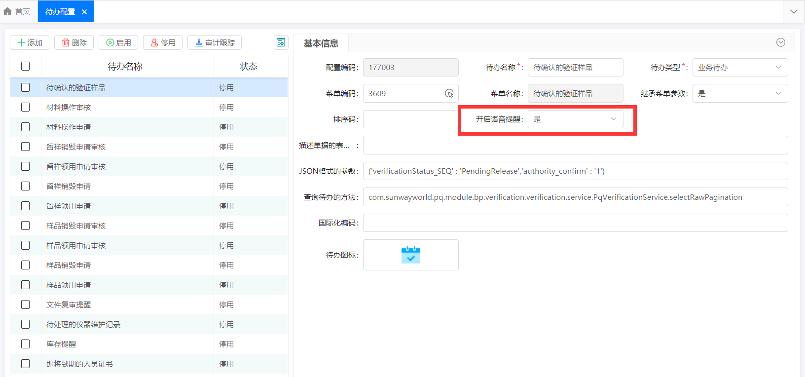

# >> 1.1.7

### 1. 版本依赖关系

#### 1.gikam-core-common1.1.7 微服务基于 gikam-core-common1.1.6
#### 2.gikam-core-base1.1.2 微服务基于 gikam-core-base1.1.1

#### 2.gikam-core-web微服务对应版本为1.1.12

# 2. pom 文件如下修改：

```xml
<dependency>
    <groupId>com.sunwayworld.cloud</groupId>
    <artifactId>gikam-core-web</artifactId>
    <version>1.1.12</version>
</dependency>
<dependency>
    <groupId>com.sunwayworld.cloud</groupId>
    <artifactId>gikam-core-common</artifactId>
    <version>1.1.7</version>
</dependency>
<dependency>
    <groupId>com.sunwayworld.cloud</groupId>
    <artifactId>gikam-core-base</artifactId>
    <version>1.1.2</version>
</dependency>
```

# 3. 修复问题如下：

#### 1.**本次补丁需要更新 SQL，SQL 内容请在 QQ 群【SWLIMS V12 开发交流群】群文件【SWLIMS V12 补丁\_1.1.7.zip】-> 1.1.7 补丁 sql 文件夹中查看**

#### 2.系统增加在线即时聊天功能

​	（a）在index.html 的workspace对象增加增加配置如下：


​	（b）系统打开后效果如下：

​	系统右下角有聊天头像


点击聊天头像打开聊天窗口


#### 3.待办配置增加语音提醒控制功能，在待办配置菜单中通过配置是否开启语音提醒进行待办的语音提醒配置

