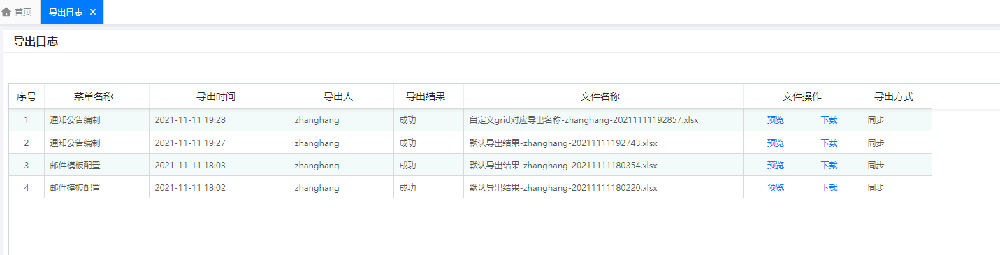

# >> 1.1.8

### 1. 版本依赖关系

#### 1.gikam-core-common1.1.8 微服务基于 gikam-core-common1.1.7
#### 2.gikam-core-web微服务对应版本为1.1.12

# 2. pom 文件如下修改：

```xml
<dependency>
    <groupId>com.sunwayworld.cloud</groupId>
    <artifactId>gikam-core-web</artifactId>
    <version>1.1.12</version>
</dependency>
<dependency>
    <groupId>com.sunwayworld.cloud</groupId>
    <artifactId>gikam-core-common</artifactId>
    <version>1.1.8</version>
</dependency>
```

# 3. 修复问题如下：

#### 1.**本次补丁需要更新 SQL，SQL 内容请在 QQ 群【SWLIMS V12 开发交流群】群文件【SWLIMS V12 补丁\_1.1.8.zip】-> 1.1.8 补丁 sql 文件夹中查看**

#### 2.Grid导出日志记录、导出Excel文件支持在线预览、可全局控制是否记录导出日志

​	（a）在项目workspace目录下的index.html 增加Grid全局导出属性如下：


​	（b）通过grid指定name属性，对应导出Excel文件名称如下：

​	


​	（c）导出日志菜单效果如下：



图中文件操作列，对应的预览按钮的显示或隐藏跟随前端uploader组件的preview参数全局属性设置。